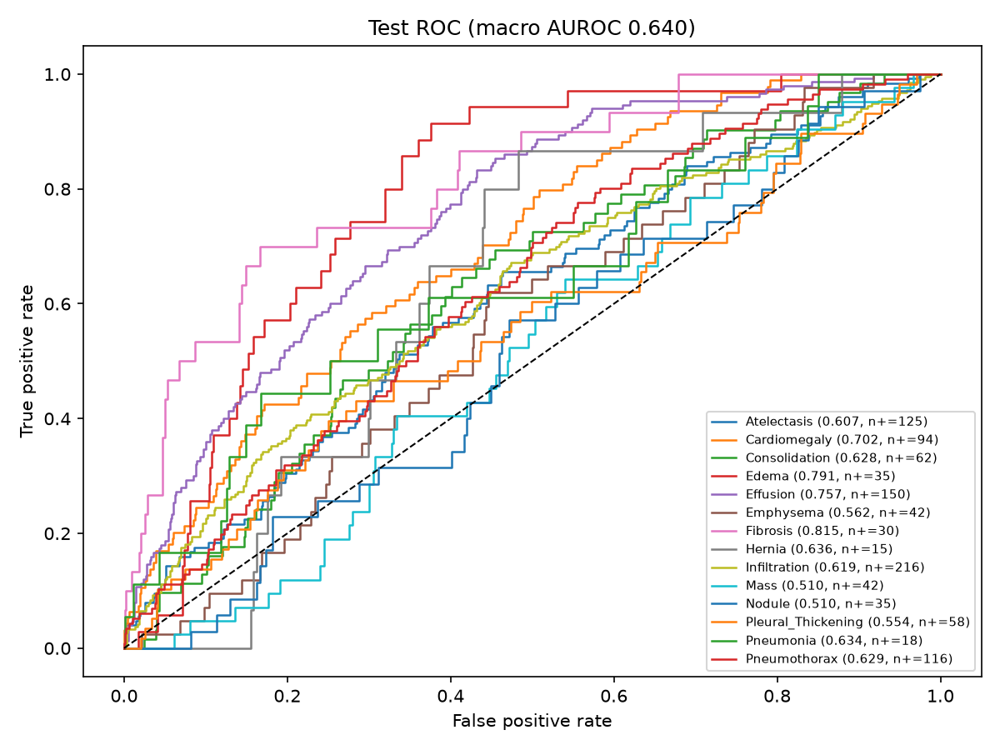

# CXR Insight — Chest X-Ray Analysis & Report Generation

**CXR Insight: Chest X-Ray Classification and Vision-Language Report Generation**
Hospital internship research prototype, rebuilt as a reproducible pipeline.

> **Research demo — not for clinical diagnosis.** No result here has been
> clinically validated. Do not use any output for a medical decision.

Maintainer: Abir Ahmmed ([@devbyabir](https://github.com/devbyabir)).
Third-party data, models and code are credited in [ATTRIBUTION.md](ATTRIBUTION.md).

## What it does

1. **Multi-label classification** of 14 NIH ChestX-ray14 findings with EfficientNet-B0.
   An image can have several findings; "No Finding" means none of the 14 is present.
2. **Grad-CAM** to show which image regions raised a finding's score.
3. **Report drafting.** The free CPU demo fills a fixed template from the classifier
   scores. A small vision-language model (VLM) can be fine-tuned on free Colab to
   write reports, but that needs report data with documented provenance (see
   [Status](#status)).

## Architecture

```
NIH metadata + images ──► cxr-nih-prepare ──► train / validation / test (by patient;
                                              official NIH test list frozen)
                                   │
                                   ▼
          cxr-train-cnn (train-only augmentation, resumable checkpoints,
                         best validation macro AUROC, validation thresholds)
                                   │ classifier.pt + run_metadata.json
                    ┌──────────────┴───────────────┐
                    ▼                              ▼
  cxr-evaluate-cnn (test once:          streamlit_app.py (upload → scores →
  per-class metrics, AUROC + CI,        Grad-CAM → template draft; in memory)
  ROC, confusion matrices)
                    
Report generation (GPU, Colab): notebooks/finetune_vlm_colab.ipynb
  LoRA fine-tune ─► verify trained adapter loads ─► baseline vs fine-tuned on the
  same test cases ─► cxr_insight.report_eval
```

| Module | Purpose |
|---|---|
| `nih.py` | Multi-label NIH manifest and patient-grouped splits |
| `data.py` | Validation, deduplication and patient splits for image–report manifests (report data); NIH classification data uses `nih.py` |
| `legacy.py` | Audit and deduplicate the legacy synthetic report CSV |
| `cnn.py` | Shared preprocessing, augmentation, EfficientNet-B0, Grad-CAM |
| `train_cnn.py` / `evaluate_cnn.py` | Resumable training; one-time test evaluation |
| `metrics.py` | Exact AUROC, per-class metrics, patient-level bootstrap CI |
| `models.py` / `inference.py` | VLM loading (trained adapters only, verified), neutral default prompt, report parsing |
| `report_eval.py` | Held-out report comparison (structure, finding agreement) |
| `config.py` / `runinfo.py` | Typed configs read by `cxr-train-cnn --config` and the VLM notebook; commit, versions, seed and data hashes per run |
| `demo.py` + `streamlit_app.py` | Demo logic and UI |

## Setup

CPU is enough for the CNN and demo; the VLM notebook runs on a Colab GPU. CI tests the
dependency-free core on Python 3.11–3.13 and the full stack on 3.12; development used 3.14.

```bash
python -m venv .venv
.venv/Scripts/python -m pip install -r requirements.txt   # Linux/macOS: .venv/bin/python
.venv/Scripts/python -m pip install -e .
python -m unittest discover -s tests -v
```

## Reproduce

Data (not in this repository): NIH ChestX-ray14 metadata and image archives from
https://nihcc.app.box.com/v/ChestXray-NIHCC (the commands below use the Hugging Face
mirror of the same files). Remove `__MACOSX/` from extracted archives.

```bash
B=https://huggingface.co/datasets/alkzar90/NIH-Chest-X-ray-dataset/resolve/main/data
mkdir -p data/raw/nih && cd data/raw/nih
curl -LO $B/Data_Entry_2017_v2020.csv -LO $B/test_list.txt -LO $B/images/images_001.zip
unzip -q images_001.zip -x "__MACOSX/*" -d images_001 && cd ../../..

cxr-nih-prepare --data-entry data/raw/nih/Data_Entry_2017_v2020.csv \
  --test-list data/raw/nih/test_list.txt --image-dir data/raw/nih/images_001 \
  --output data/splits/nih_images001_seed42
cxr-train-cnn --config configs/cnn_nih_images001.toml   # exact settings of the reported run
cxr-evaluate-cnn --checkpoint runs/cnn_nih_images001_seed42/classifier.pt \
  --splits data/splits/nih_images001_seed42 --image-dir data/raw/nih/images_001 \
  --out runs/cnn_nih_images001_seed42/test_eval
```

Command-line flags override the config (e.g. `--epochs 2`). Re-running
`cxr-train-cnn` with the same arguments resumes from `last.pt`;
`--session-epochs N` stops cleanly after N epochs (useful on free Colab).
Full-dataset training on free Colab: [notebooks/train_cnn_colab.ipynb](notebooks/train_cnn_colab.ipynb).

Demo:

```bash
# .streamlit/secrets.toml (git-ignored):  CXR_CLASSIFIER_PATH = "runs/<run>/classifier.pt"
streamlit run streamlit_app.py
```

For a hosted demo, publish `classifier.pt` as a GitHub Release asset and set
`CXR_CLASSIFIER_URL` and `CXR_CLASSIFIER_SHA256` in the host's secrets. The app
downloads it once (60 s timeout, 200 MB cap), checks the hash before caching it, and
loads it with `torch.load(weights_only=True)`. Uploads are handled in memory only and are
limited to PNG/JPEG, 10 MB and 36 megapixels, so a small compressed file cannot expand
into gigabytes of memory.

## Results

### CNN, NIH ChestX-ray14 subset (measured 2026-11-14)

**Scope: these numbers describe a 4,999-image subset (archive `images_001`, about
4.5% of the 112,120 images), not the full dataset.** They are not comparable
to full-dataset benchmarks and say nothing about clinical performance.

| Setting | Value |
|---|---|
| Data | NIH ChestX-ray14 `images_001`: train 3,429 images / 1,082 patients; validation 603 / 191; test 967 / 62 (NIH official test list) |
| Model | EfficientNet-B0 (ImageNet init), 224×224, BCE loss, AdamW, one-cycle LR 3e-4, batch 32, 6 epochs, seed 42 |
| Hardware | CPU only, about 3.5 min per epoch |
| Selection | Best validation macro AUROC (epoch 3); per-class thresholds fitted on validation |
| Code | commit `5482cbb` (identical source to the run); torch 2.15.0+cpu, torchvision 0.29.2, Python 3.14.7 |

| Split | Macro AUROC (14 labels) |
|---|---|
| Validation (model selection) | 0.722 |
| **Test (evaluated once)** | **0.640** (95% CI 0.605–0.664, bootstrap over patients) |

Test micro precision / recall / F1 at the validation thresholds: 0.138 / 0.547 / 0.220.
Per-class test AUROC ranged from 0.510 (Mass, Nodule) to 0.815 (Fibrosis). Several
classes have few positives (e.g. Hernia 15, Pneumonia 18), so their values are unstable.
Full per-class metrics, confusion counts, raw predictions, the ROC plot and run
metadata are in [docs/results/cnn_nih_images001_seed42](docs/results/cnn_nih_images001_seed42).



Validation-to-test drop: the test set comes from only 62 patients with many
follow-up images, and NIH's test patients differ in label mix from train/validation.
Low thresholds favour recall, so the demo flags many false positives.

**Legacy results (not valid):** the original notebooks reported about 99% accuracy.
That figure came from augmentation and patient leakage across splits; see
[docs/AUDIT.md](docs/AUDIT.md).

### Report generation

No VLM has been fine-tuned or evaluated yet, so there are no report-generation
results. The evaluation tooling (`cxr_insight.report_eval`, baseline vs fine-tuned
on identical test cases) is in place and tested.

## Limitations

- NIH labels were mined from radiology reports by NLP and are noisy; the
  official test labels are not expert-adjudicated.
- Results from a subset of the images describe that subset only.
- Test sets drawn from few patients give wide confidence intervals.
- Grad-CAM shows what influenced a score, not where disease is.
- The template draft report only restates classifier scores. It is not a
  radiology report and has no clinical meaning.
- The CNN takes any image. It does not check that the upload is a chest X-ray.
- No VLM has been fine-tuned or evaluated in this repository yet.

## Status

| Part | State |
|---|---|
| Legacy audit and data cleaning | Done ([docs/AUDIT.md](docs/AUDIT.md), [docs/PROVENANCE.md](docs/PROVENANCE.md)) |
| Patient-grouped multi-label NIH pipeline | Done |
| CNN trained and evaluated | Subset only (see Results) |
| Streamlit demo | Tested locally (upload, scores, Grad-CAM, draft, error states) |
| VLM fine-tuning | Notebook ready; needs report data with documented provenance and a Colab GPU run |
| Hosted demo | Not deployed: needs `classifier.pt` as a GitHub Release asset and a Streamlit Community Cloud sign-in |
| Full-dataset CNN | Not run: [notebooks/train_cnn_colab.ipynb](notebooks/train_cnn_colab.ipynb) with all 12 archives |

See also the [evaluation protocol](docs/EVALUATION.md).

## Model card (CNN)

| | |
|---|---|
| Model | EfficientNet-B0 (ImageNet-1k init), 14 sigmoid outputs |
| Intended use | Research and teaching: exploring multi-label CXR classification, evaluation practice and explainability |
| Out of scope | Diagnosis, triage, screening or any decision about a patient; non-chest or non-radiograph images; paediatric or lateral views (not evaluated) |
| Training data | NIH ChestX-ray14 archive `images_001` (3,429 training images, 1,082 patients); labels mined from reports by NLP |
| Evaluation | Frozen NIH test list subset: 967 images, 62 patients; macro AUROC 0.640 (95% CI 0.605–0.664) |
| Known failure modes | Low precision at validation thresholds (many false flags); near-chance AUROC for Mass and Nodule; no out-of-distribution check |
| Explainability | Grad-CAM on the last convolutional block; indicates influence, not lesion location |

## License

Code: MIT ([LICENSE](LICENSE)). Data, model weights and third-party software keep
their own terms ([ATTRIBUTION.md](ATTRIBUTION.md)).
