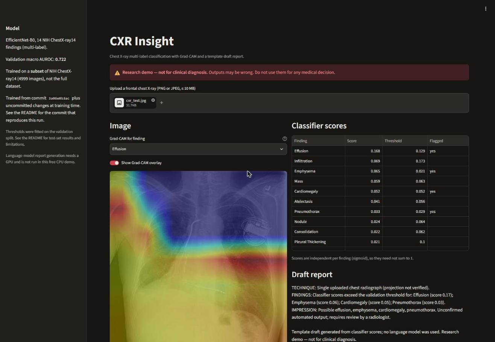
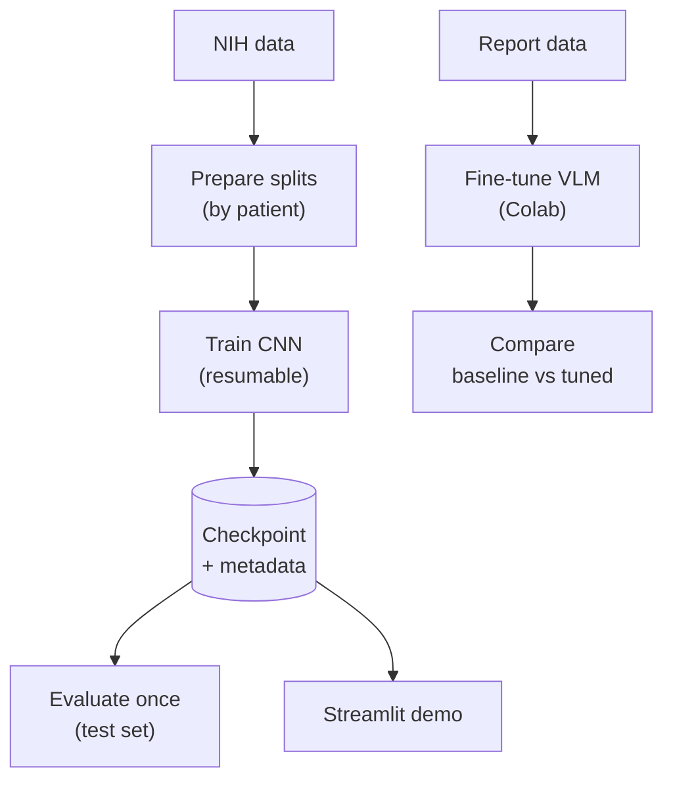

<div align="center">

# 🩻 CXR Insight

### Chest X-Ray Classification and Vision-Language Report Generation

A hospital-internship research prototype, rebuilt as an audited and reproducible pipeline:
multi-label chest X-ray classification, Grad-CAM explanations and a draft-report demo.

<a href="https://cxr-insight.streamlit.app/">
  
</a>

**[▶ Try the live demo](https://cxr-insight.streamlit.app/)** ·
[Results](#-results) ·
[Model checkpoint](https://github.com/devbyabir/cxr-insight/releases/tag/cnn-nih-images001-seed42) ·
[Reproduce](#-reproduce) ·
[Legacy audit](docs/AUDIT.md)

[](https://github.com/devbyabir/cxr-insight/actions/workflows/tests.yml)
[](LICENSE)


</div>

> [!WARNING]
> **Research demo — not for clinical diagnosis.** Nothing here has been clinically validated.
> Do not use any output for a medical decision.

<p align="center">
  <a href="https://cxr-insight.streamlit.app/">
    
  </a>
  <br><sub>The live demo on an NIH ChestX-ray14 test image: per-finding scores, Grad-CAM and a template draft report.</sub>
</p>

---

## ✨ Highlights

| | |
|---|---|
| 🔬 **Multi-label classification** | EfficientNet-B0 scores 14 NIH ChestX-ray14 findings independently. One image can have several findings; "No Finding" means none of the 14 is present. |
| 🧭 **Patient-level splits** | NIH's official patient-wise test list is kept frozen. Train and validation are split by patient, so no patient appears in two splits. |
| 🔥 **Grad-CAM** | Shows which regions raised a finding's score (influence, not lesion location). |
| 📝 **Draft report** | The free CPU demo fills a fixed template from the classifier scores and says so. A vision-language model can be fine-tuned on free Colab (notebook included). |
| 📏 **Honest evaluation** | Model selection on validation only, a single test run, exact AUROC with patient-level bootstrap CIs, and raw predictions published. |
| 🛡️ **Safe demo** | Uploads stay in memory; PNG/JPEG only, 10 MB and 36-megapixel limits; the checkpoint is hash-checked and loaded with `weights_only=True`. |
| 🔁 **Reproducible** | Typed configs, resumable checkpoints, and run metadata (commit, package versions, seed, data hashes). |

## 📊 Results at a glance

> Measured on a **subset** of NIH ChestX-ray14 (archive `images_001`, 4,999 images,
> about 4.5% of the dataset). These numbers describe that subset only.

| Split | Images / patients | Macro AUROC (14 findings) |
|---|---|---|
| Validation (model selection) | 603 / 191 | 0.722 |
| **Test** (NIH official list, evaluated once) | 967 / 62 | **0.640** (95% CI 0.605–0.664) |

The legacy notebooks reported about **99% accuracy**. That figure came from augmentation
and patient leakage across splits, and is not valid. See [docs/AUDIT.md](docs/AUDIT.md).

## 🚀 Quick start

**Online:** open **[cxr-insight.streamlit.app](https://cxr-insight.streamlit.app/)** and upload
a frontal chest X-ray (PNG or JPEG). Nothing is stored.

**Locally:**

```bash
git clone https://github.com/devbyabir/cxr-insight.git && cd cxr-insight
python -m venv .venv
.venv/Scripts/python -m pip install -r requirements.txt   # Linux/macOS: .venv/bin/python
.venv/Scripts/python -m pip install -e .
python -m unittest discover -s tests -v
```

Run the demo with the published checkpoint by putting this in `.streamlit/secrets.toml`
(git-ignored), then `streamlit run streamlit_app.py`:

```toml
CXR_CLASSIFIER_URL = "https://github.com/devbyabir/cxr-insight/releases/download/cnn-nih-images001-seed42/cxr-insight-cnn-nih-images001-seed42-fp16.pt"
CXR_CLASSIFIER_SHA256 = "5b77dd7c6421573dd49cfddc1a60d4bd555004ee00e3443b667d5963e70b096f"
```

Use `CXR_CLASSIFIER_PATH = "runs/<run>/classifier.pt"` instead for a checkpoint you trained.
The app downloads a URL once (60 s timeout, 200 MB cap), checks the hash before caching it,
and refuses a file that does not match.

## 🏗️ Architecture



| Step | Command / file | What it guarantees |
|---|---|---|
| Prepare splits | `cxr-nih-prepare` | Official NIH test list frozen; train/validation split by patient |
| Train CNN | `cxr-train-cnn --config …` | Augmentation on training data only; per-epoch checkpoints and resume; model chosen on validation macro AUROC |
| Evaluate once | `cxr-evaluate-cnn` | Per-class metrics, AUROC with patient-bootstrap CI, ROC and confusion plots, raw predictions |
| Streamlit demo | `streamlit_app.py` | In-memory uploads, scores, Grad-CAM, template draft |
| Fine-tune VLM | `notebooks/finetune_vlm_colab.ipynb` | LoRA on free Colab with resume; trained adapter verified on reload |
| Compare | `cxr_insight.report_eval` | Baseline and fine-tuned models on the same held-out cases |

<details>
<summary><b>Modules</b></summary>

| Module | Purpose |
|---|---|
| `nih.py` | Multi-label NIH manifest and patient-grouped splits |
| `data.py` | Validation, deduplication and patient splits for image–report manifests (report data) |
| `legacy.py` | Audit and deduplicate the legacy synthetic report CSV |
| `cnn.py` | Shared preprocessing, train-only augmentation, EfficientNet-B0, Grad-CAM |
| `train_cnn.py` / `evaluate_cnn.py` | Resumable training; one-time test evaluation |
| `metrics.py` | Exact AUROC, per-class metrics, patient-level bootstrap CI |
| `models.py` / `inference.py` | VLM loading (trained adapters only, verified), neutral default prompt, report parsing |
| `report_eval.py` | Held-out report comparison (structure, finding agreement) |
| `config.py` / `runinfo.py` | Typed configs; commit, versions, seed and data hashes per run |
| `demo.py` + `streamlit_app.py` | Demo logic and UI |

</details>

<details>
<summary><b>Project structure</b></summary>

```
cxr-insight/
├── src/cxr_insight/        # library code (modules above)
├── tests/                  # 108 unit tests (stdlib unittest)
├── configs/                # cnn_nih_images001.toml (reported run), vlm_qwen2vl_2b.toml
├── notebooks/              # free-Colab CNN training and VLM fine-tuning (no outputs)
├── docs/                   # AUDIT, PROVENANCE, EVALUATION, results/
├── streamlit_app.py        # demo entry point
└── requirements.txt        # CPU stack for the demo and CI
```

</details>

## 🔁 Reproduce

Data is not included. Download the NIH ChestX-ray14 metadata and image archives from
the [NIH download site](https://nihcc.app.box.com/v/ChestXray-NIHCC); the commands below
use the Hugging Face mirror of the same files. Remove `__MACOSX/` from extracted archives.

```bash
B=https://huggingface.co/datasets/alkzar90/NIH-Chest-X-ray-dataset/resolve/main/data
mkdir -p data/raw/nih && cd data/raw/nih
curl -LO $B/Data_Entry_2017_v2020.csv -LO $B/test_list.txt -LO $B/images/images_001.zip
unzip -q images_001.zip -x "__MACOSX/*" -d images_001 && cd ../../..

cxr-nih-prepare --data-entry data/raw/nih/Data_Entry_2017_v2020.csv \
  --test-list data/raw/nih/test_list.txt --image-dir data/raw/nih/images_001 \
  --output data/splits/nih_images001_seed42
cxr-train-cnn --config configs/cnn_nih_images001.toml   # exact settings of the reported run
cxr-evaluate-cnn --checkpoint runs/cnn_nih_images001_seed42/classifier.pt \
  --splits data/splits/nih_images001_seed42 --image-dir data/raw/nih/images_001 \
  --out runs/cnn_nih_images001_seed42/test_eval
```

- Command-line flags override the config (e.g. `--epochs 2`).
- Re-running `cxr-train-cnn` with the same arguments resumes from `last.pt`;
  `--session-epochs N` stops cleanly after N epochs (useful on free Colab).
- Full dataset on free Colab: [notebooks/train_cnn_colab.ipynb](notebooks/train_cnn_colab.ipynb).
- Report generation on free Colab: [notebooks/finetune_vlm_colab.ipynb](notebooks/finetune_vlm_colab.ipynb).

## 📈 Results

<details open>
<summary><b>CNN on the NIH ChestX-ray14 <code>images_001</code> subset (measured 2026-11-14)</b></summary>

| Setting | Value |
|---|---|
| Data | Train 3,429 images / 1,082 patients; validation 603 / 191; test 967 / 62 (NIH official test list) |
| Model | EfficientNet-B0 (ImageNet init), 224×224, BCE loss, AdamW, one-cycle LR 3e-4, batch 32, 6 epochs, seed 42 |
| Hardware | CPU only, about 3.5 min per epoch |
| Selection | Best validation macro AUROC (epoch 3); per-class thresholds fitted on validation |
| Code | Tag [`cnn-nih-images001-seed42`](https://github.com/devbyabir/cxr-insight/releases/tag/cnn-nih-images001-seed42) (commit `5482cbb`); torch 2.15.0+cpu, torchvision 0.29.2, Python 3.14.7 |

| Metric (test, validation thresholds) | Value |
|---|---|
| Macro AUROC | **0.640** (95% CI 0.605–0.664, bootstrap over patients) |
| Micro precision / recall / F1 | 0.138 / 0.547 / 0.220 |
| Per-class AUROC range | 0.510 (Mass, Nodule) to 0.815 (Fibrosis) |

Several classes have few positives (e.g. Hernia 15, Pneumonia 18), so their values are unstable.
The drop from validation to test reflects a test set from only 62 patients with many follow-up
images and a different label mix. Low thresholds favour recall, so the demo flags many false
positives. Per-class metrics, confusion counts, raw predictions, plots and run metadata are in
[docs/results/cnn_nih_images001_seed42](docs/results/cnn_nih_images001_seed42).

<p align="center"></p>

</details>

**Report generation:** no VLM has been fine-tuned or evaluated yet, so there are no
report-generation results. The evaluation tooling (`cxr_insight.report_eval`, baseline vs
fine-tuned on identical test cases) is in place and tested.

## 🗂️ Model card (CNN)

| | |
|---|---|
| Model | EfficientNet-B0 (ImageNet-1k init), 14 sigmoid outputs |
| Intended use | Research and teaching: multi-label CXR classification, evaluation practice, explainability |
| Out of scope | Diagnosis, triage, screening or any decision about a patient; non-chest or non-radiograph images; paediatric or lateral views (not evaluated) |
| Training data | NIH ChestX-ray14 archive `images_001` (3,429 training images, 1,082 patients); labels mined from reports by NLP |
| Evaluation | Frozen NIH test-list subset: 967 images, 62 patients; macro AUROC 0.640 (95% CI 0.605–0.664) |
| Published weights | [Release asset](https://github.com/devbyabir/cxr-insight/releases/tag/cnn-nih-images001-seed42): float16 copy of the trained weights (8.2 MB); re-evaluated on the same test set with macro AUROC 0.6395 vs 0.6396 (float32) |
| Known failure modes | Low precision at validation thresholds (many false flags); near-chance AUROC for Mass and Nodule; no check that the upload is a chest X-ray |
| Explainability | Grad-CAM on the last convolutional block; indicates influence, not lesion location |

## ⚠️ Limitations

- NIH labels were mined from radiology reports by NLP and are noisy; the official test labels
  are not expert-adjudicated.
- Results from a subset describe that subset only; few test patients give wide intervals.
- Grad-CAM shows what influenced a score, not where disease is.
- The template draft report only restates classifier scores. It is not a radiology report.
- The demo does not check that an upload is a chest X-ray.
- No VLM has been fine-tuned or evaluated in this repository yet.

## 🧾 Project status

| Part | Status |
|---|---|
| Legacy audit and data cleaning | ✅ Done — [AUDIT](docs/AUDIT.md), [PROVENANCE](docs/PROVENANCE.md) |
| Patient-grouped multi-label NIH pipeline | ✅ Done |
| CNN trained and evaluated | ✅ Subset (`images_001`) — see [Results](#-results) |
| Live demo | ✅ [cxr-insight.streamlit.app](https://cxr-insight.streamlit.app/) |
| Checkpoint release | ✅ [cnn-nih-images001-seed42](https://github.com/devbyabir/cxr-insight/releases/tag/cnn-nih-images001-seed42) |
| Full-dataset CNN | 🔜 Future work — [Colab notebook](notebooks/train_cnn_colab.ipynb) with all 12 archives |
| VLM report generation | 🔜 Future work — needs report data with documented provenance and a Colab GPU run |

See also the [evaluation protocol](docs/EVALUATION.md).

## 🙏 Attribution and license

- **Data:** NIH ChestX-ray14, provided by the NIH Clinical Center
  ([download site](https://nihcc.app.box.com/v/ChestXray-NIHCC)); Wang X. et al.,
  *ChestX-ray8*, IEEE CVPR 2017.
- **Methods and libraries:** EfficientNet (Tan & Le, 2019; torchvision weights), Grad-CAM
  (Selvaraju et al., 2017), Unsloth (VLM notebook), PyTorch, Streamlit.
  Full credits in [ATTRIBUTION.md](ATTRIBUTION.md).
- **License:** code under [MIT](LICENSE). Data, model weights and third-party software keep
  their own terms.

<div align="center">

Maintained by **Abir Ahmmed** ([@devbyabir](https://github.com/devbyabir))

</div>
